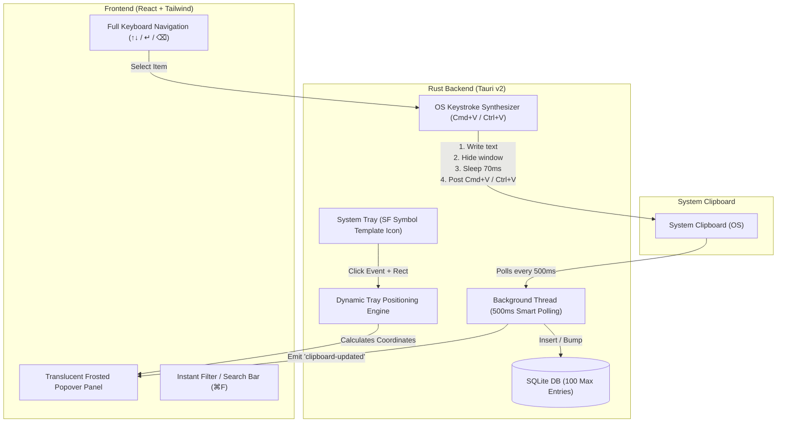

# Cliptray: Cross-Platform Menu Bar Clipboard Manager

Cliptray is a lightweight, high-performance clipboard manager designed with pixel-perfect adherence to **Apple's Human Interface Guidelines (HIG)** on macOS, while operating natively and efficiently on **Windows** and **Linux**.

Built on **Tauri v2**, **Rust**, **React**, and **Tailwind CSS**, Cliptray lives quietly in your menu bar or notification area and stays completely out of the dock/taskbar until summoned.

---

## Architecture Overview



---

## Key Features

1. **Native Menu Bar Popover (Apple HIG Matching)**
   - **Translucent Vibrancy**: Utilizes macOS `NSVisualEffectMaterial::HudWindow` (and Windows Acrylic) paired with Tailwind's `backdrop-blur-xl bg-white/75 dark:bg-[#1c1c1e]/80`.
   - **Strict Accessory Mode**: Set to `tauri::ActivationPolicy::Accessory`, completely hiding the app icon from the macOS Dock.
   - **Click & Blur Dismissal**: Automatically hides on blur (`WindowEvent::Focused(false)`) or when pressing `Escape`.

2. **Dynamic Tray Positioning Engine**
   - Intercepts Tauri v2 `TrayIconEvent::Click` with the tray icon's bounding rectangle (`Rect`).
   - **macOS**: Centers the window directly beneath the menu bar icon with a 6px offset.
   - **Windows & Linux**: Detects whether the taskbar is situated at the bottom, top, or sides, and places the window right adjacent to the notification area with safe monitor edge clamping.

3. **Smart Clipboard Polling (Zero CPU Overhead)**
   - Continuous background thread checking the system clipboard via `arboard`.
   - Polling runs at 500ms intervals, avoiding tight CPU loops and maintaining 0% idle CPU and zero battery drain.
   - Ignores internal copy operations triggered during auto-paste to avoid duplicate entries.

4. **Instant Auto-Paste Keystroke Synthesis**
   - Selecting any clip via `Return` or mouse click:
     1. Copies the selected content to the system clipboard.
     2. Immediately hides the Cliptray window.
     3. Waits a 70ms grace period for the window manager to hand focus back to the target application (VS Code, Chrome, Terminal, Slack, etc.).
     4. Programmatically synthesizes a native `Command + V` (macOS CoreGraphics HID event) or `Control + V` (Windows/Linux via Enigo).

5. **Local SQLite Persistence & Auto-Pruning**
   - Stores clipboard history in a local SQLite database (`history.db`) via `rusqlite` bundled.
   - Automatically classifies items: **Link**, **Color** (with swatch preview), **JSON**, **Code**, or **Text**.
   - Preserves up to 100 recent entries while permanently preserving any pinned/starred clips.

6. **Full Keyboard Accessibility**
   - `↑` / `↓`: Seamlessly scroll and select items.
   - `↵` (Return): Auto-paste selected item into the active application.
   - `⌘1` – `⌘9`: Instantly paste one of the top 9 items.
   - `⌘F`: Focus search bar to filter clips instantly.
   - `⌘P`: Star/Pin item to top.
   - `⌫` (Delete): Delete selected item.
   - `⌘⇧⌫`: Clear all unpinned history.
   - `esc`: Clear search bar or dismiss window.

---

## Codebase Structure

```text
clipboard-manager/
├── package.json               # Frontend dependencies & Tauri CLI
├── vite.config.js             # Vite configuration with Tauri platform targets
├── tailwind.config.js         # Apple HIG system fonts, colors, and shadows
├── postcss.config.js          # Tailwind CSS processor
├── index.html                 # Popover HTML root with antialiasing
├── src/
│   ├── main.jsx              # React entry point
│   ├── App.jsx               # Main state, IPC bridges, hotkeys & layout
│   ├── index.css             # Glassmorphism, vibrancy & thin scrollbars
│   ├── utils/
│   │   └── formatters.js     # Relative time, type detection & preview helpers
│   └── components/
│       ├── Header.jsx        # App title, item count & clear action
│       ├── SearchBar.jsx     # Borderless instant search (⌘F)
│       ├── FilterTabs.jsx    # Segmented pill controls (All, Starred, Links...)
│       ├── ClipboardList.jsx # Scroll view with auto-scroll-to-selected
│       ├── ClipboardItem.jsx # Single clip card with type badge, preview & hotkeys
│       ├── EmptyState.jsx    # Apple-style empty illustration
│       ├── Footer.jsx        # Keyboard shortcuts reference bar
│       └── Toast.jsx         # Ephemeral HUD feedback
└── src-tauri/
    ├── Cargo.toml            # Rust dependencies (Tauri v2, arboard, rusqlite, core-graphics)
    ├── tauri.conf.json       # Window geometry, accessory mode & bundle config
    ├── build.rs              # Tauri v2 build pipeline
    ├── capabilities/
    │   └── default.json      # Tauri v2 window and event permissions
    ├── icons/
    │   ├── tray-icon.png     # SF Symbols style 'doc.on.clipboard' monochrome template
    │   ├── 32x32.png         # Multi-resolution icons
    │   ├── 128x128.png
    │   ├── 128x128@2x.png
    │   └── icon.png
    └── src/
        ├── main.rs           # App bootstrap, window vibrancy, blur listeners & IPC commands
        ├── clipboard.rs      # Continuous 500ms smart clipboard monitor thread
        ├── position.rs       # Exact tray coordinate calculation & monitor clamping
        ├── storage.rs        # SQLite schema, pruning & item classification
        ├── input.rs          # Cross-platform Cmd+V / Ctrl+V keystroke synthesis
        └── tray.rs           # Custom template tray icon setup & click event routing
```

---

## Installation (macOS)

### 1. Download & Install
1. Download the latest `Cliptray_x.x.x_aarch64.dmg` from the **[Releases](../../releases)** page.
2. Open the `.dmg` file and drag **Cliptray** into your **Applications** folder.

### 2. First-Time Launch (Bypassing macOS Gatekeeper)
Because Cliptray is an independent, free, and open-source project without a paid Apple Developer certificate, macOS Gatekeeper may show a warning:  
> *"Cliptray is damaged and can't be opened. You should eject the disk image."*

To open it, use either of the following methods:

#### Method A: Terminal (Instant 1-Liner)
Open **Terminal** and run:
```bash
xattr -cr /Applications/Cliptray.app
```
Then launch **Cliptray** from Applications or Spotlight.

#### Method B: Settings GUI (No Terminal)
1. Try to open **Cliptray** from Applications (click **Done** / **Cancel** on the alert).
2. Go to **System Settings → Privacy & Security**.
3. Scroll down to the **Security** section where you'll see:  
   *"Cliptray was blocked from use because it is not from an identified developer."*
4. Click **Open Anyway** and enter your Mac password / Touch ID.

---

### 3. Grant Accessibility Permission (Required for Auto-Paste)
Cliptray synthesizes a native keystroke (`⌘V`) when you select a clip to paste it directly into your active app (VS Code, Chrome, Slack, etc.).

When prompted on first use, enable Cliptray in:  
**System Settings → Privacy & Security → Accessibility → Cliptray (ON)**.

---

## Development & Building from Source

### Prerequisites

1. **Node.js** (v18+) and `npm`
2. **Rust & Cargo** (1.75+)
   ```bash
   curl --proto '=https' --tlsv1.2 -sSf https://sh.rustup.rs | sh
   ```
3. **OS-specific build tools**:
   - **macOS**: Xcode Command Line Tools (`xcode-select --install`)
   - **Linux**: `libwebkit2gtk-4.1-dev`, `build-essential`, `libappindicator3-dev`, `librsvg2-dev`
   - **Windows**: Microsoft Visual Studio C++ Build Tools & WebView2

### Installation & Local Run

1. Clone or navigate to the workspace:
   ```bash
   cd clipboard-manager
   ```

2. Install frontend dependencies:
   ```bash
   npm install
   ```

3. Run in development mode:
   ```bash
   npm run tauri dev
   ```
   *The application will launch, dock itself to your menu bar with the clipboard template icon, and immediately begin syncing copied items.*

4. Build production binary:
   ```bash
   npm run tauri build
   ```
   *Outputs a DMG and `.app` on macOS, an MSI/EXE installer on Windows, and an AppImage/Deb on Linux inside `src-tauri/target/release/bundle/`.*

